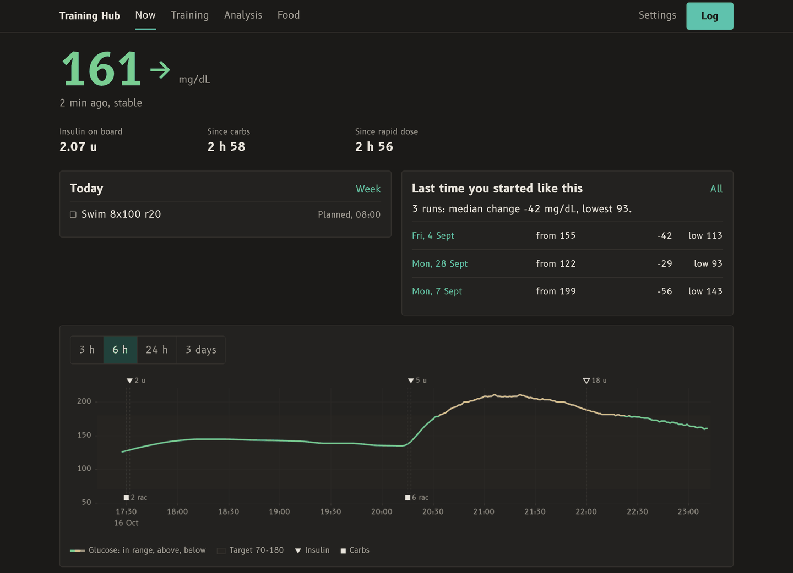
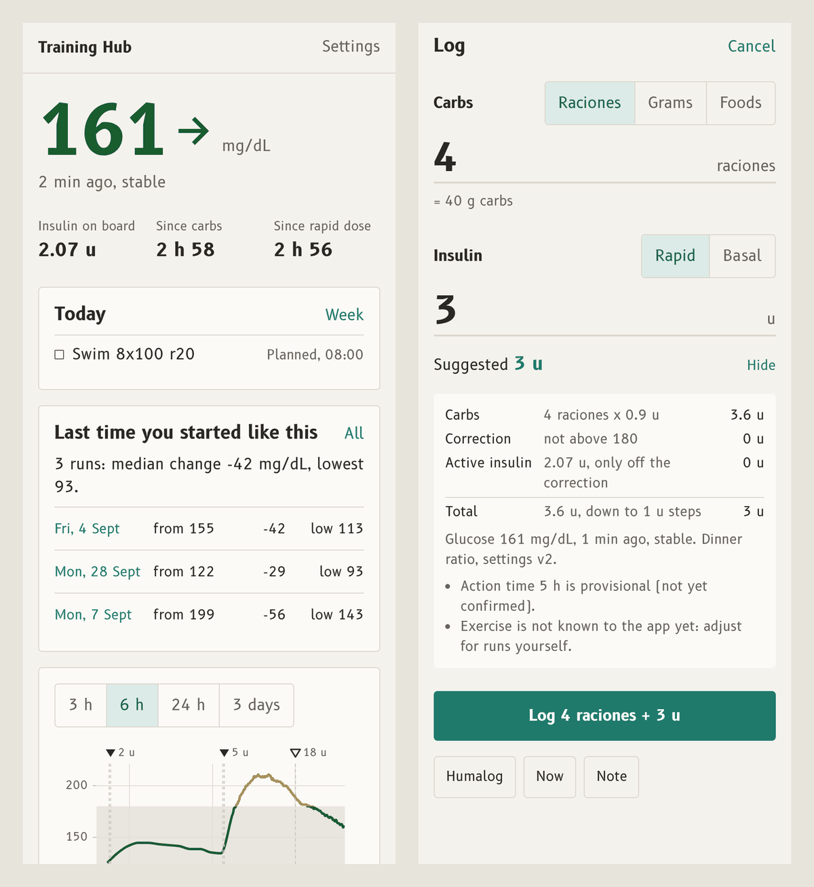
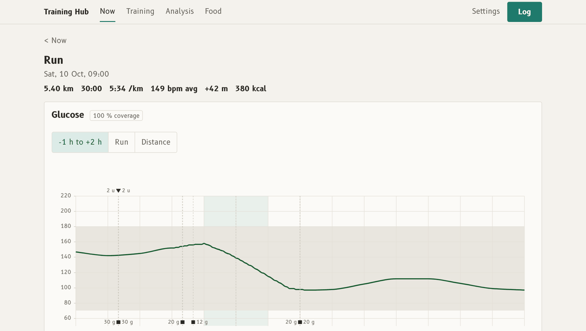
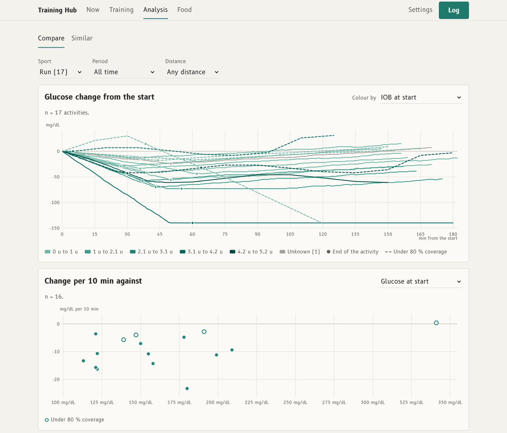
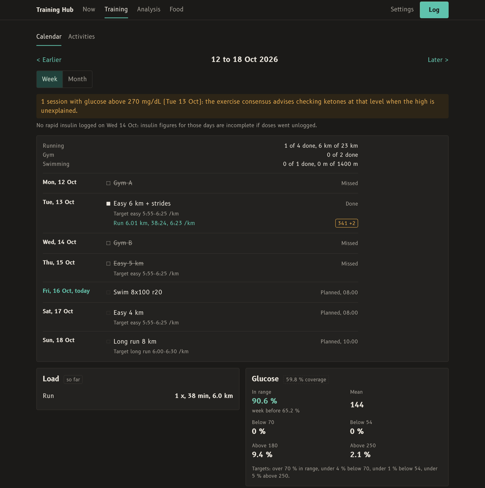

# Training Hub

A self-hosted web app that puts Garmin training, FreeStyle Libre 2 glucose and an insulin and carbs log on one
timeline, to see how exercise moves blood glucose with type 1 diabetes, and to learn from it run by run.



> **Not a medical device.** This is a personal project, built for one person and shared as an example. It has not
> been validated for anyone's treatment. Its insulin calculator only applies the parameters you type in; it does not
> know whether they are right for you. Never change a dose or a setting because of this app without your diabetes
> team.

## Why

A sensor app shows glucose, a sports watch shows the run, and a notebook shows the insulin and the food. The
questions that matter before a run ("I am at 150 and falling with 2 u on board: what happened the last times?")
need all three at once, minute by minute, and enough history to compare. Training Hub collects them
automatically where it can, makes the rest quick to log, and keeps every number traceable to its source.

## What it does

### Now: can I train, and how did it go last time?

The current reading in its range colour, its trend and age (a stale reading never looks current), insulin on board,
time since the last carbs and dose, today's planned session, and the past runs that started closest to the current
state. The glucose line joins live 1-minute readings and the sensor's 15-minute history into one curve, coloured by
range, with doses and carbs marked on it.

### Log: carbs and insulin in one tap



Carbs as raciones, grams or a meal built from foods; rapid or basal insulin; both saved together. For a rapid dose,
the calculator fills the insulin field as the carbs are typed: carbs part from the meal slot's ratio, a correction
above the target, minus insulin on board (off the correction only), rounded down to the pen increment. "Why" shows
every term. The field stays editable; Log, whose label names both amounts, is the confirmation.

### Every run, with glucose first



Activities sync from Garmin twice a day (or a FIT file is uploaded). Each run gets glucose from 1 h before to 2 h
after next to heart rate, pace and elevation on one cursor, the context before it (insulin on board, last meal,
start glucose and trend), flags decided by code (a start above 270 mg/dL, going low, thin sensor coverage), the
earlier runs that started like it, a note, and an AI-written analysis.

### Analysis: patterns across runs



Every run as glucose change from its start, coloured by a context variable (insulin on board, start glucose, time of
day, time since the last meal); change per 10 minutes against any of them; a table of everything. Sample sizes and
low-coverage runs are always shown, so a pattern from three runs does not look like one from thirty.

### Training: plan against done



A training plan imported from calendar files, matched to the activities that were actually done (done, partial,
missed, moved), with pace targets from your zones. Under it, the week's load and its glucose against the
international time-in-range targets, the nights after training, and each day's log.

### Also

- **Food**: the CIQUAL table of generic foods, packaged products by barcode scan (Open Food Facts), your own foods
  and recipes, with carbs and the other macros totalled per meal.
- **AI reports**: a short analysis after each run and each week, on Gemini or Claude. A code guard removes any sentence
  that suggests a dose or an insulin change; the AI may only say "review suggested", with the data.
- **Claude desktop connector**: a local MCP server (`connector/`) so Claude can read the data and answer questions
  about it, read-only.
- **Phone first**: installable as a PWA, every control at least 44 px on a touch screen, light and dark themes, and
  the browser's back gesture works everywhere.

## Insulin safety rules

The calculator is the part where a bug could hurt, so it follows fixed rules (see the spec, "Insulin and carbs log,
and calculator safety rules"):

- Doses are computed only by one deterministic, unit-tested module (`api/app/calculator.py`), with every term of the
  formula shown and the result rounded down to the pen increment.
- No AI or LLM call ever produces a dose.
- Insulin parameters exist only as versioned settings you save by hand; none has a default in code, and a missing
  value disables the calculator and says what is missing. The app never changes them.
- No dose is suggested below 70 mg/dL, no correction is computed from a reading older than 30 minutes, and warnings
  (stale reading, falling glucose, a young log that undercounts insulin on board) are shown, not hidden.
- Every logged dose stores the suggestion that was on screen and the settings version, so any calculation can be
  reproduced and suggested can be compared with injected.

## Architecture

```
Garmin Connect  --(twice a day)-->  garmin   -->  Postgres  <-->  api + web (FastAPI, SvelteKit PWA)
LibreLinkUp     --(every 60 s)--->  worker   -->  raw archive         |
                                    analysis --> Gemini / Claude APIs  |
phone / laptop  <-->  VPN  <-->  reverse proxy  <---------------------+
```

- **Backend**: Python 3.12, FastAPI, psycopg, Alembic migrations, fitdecode for FIT files, garminconnect for the
  sync, pylibrelinkup for glucose. PostgreSQL 16 is the single source of truth; every raw payload (FIT files,
  LibreLinkUp responses, plan files) is archived before parsing, so derived tables can always be rebuilt.
- **Frontend**: SvelteKit (Svelte 5) built as a static SPA and served by the API, uPlot for the time series.
- **Deployment**: one Docker Compose stack (database, migrations, API, Garmin sync, glucose collector, AI analysis),
  under 1.5 GB of RAM, reachable only on the LAN and through a VPN.

## Running it yourself

It is built for one user on a home server, behind a reverse proxy and a VPN. Roughly:

1. Copy `.env.example` to `.env` and fill it in (database password, session secret, optional AI keys).
2. Create the secret files in `secrets/`: `app_password_hash` (made with `python -m app.set_password <file>` in
   `api/`, with its requirements installed), and `llu_email` / `llu_password` for a LibreLinkUp follower account that follows your LibreLink app.
3. Create the raw archive folders under `./data/raw` (owned by uid 10001) and the external Docker network `proxy`
   that your reverse proxy shares, or adapt `compose.yaml` to your setup.
4. `docker compose up -d --build`. Migrations run before the API starts.
5. Log in to Garmin once by hand: `docker exec -it traininghub-garmin python -m app.garmin_login`.
6. In the app, fill in Settings > Insulin (your own parameters, from your diabetes team) and Settings > Training.

`docs/spec.md` describes every part in detail. The LibreLinkUp and Garmin Connect APIs are unofficial and can
change without notice.

## Development

```
cd api && pip install -r requirements-dev.txt && pytest      # database tests need TEST_PG_HOST (Postgres 16)
cd worker && pip install -r requirements-dev.txt && pytest
cd web && npm ci && npm run dev
```

Over 470 tests cover the FIT parser, the glucose joins, the calculator (checked against hand calculations), the
log, foods and meals, the run metrics, the calendar matching and the AI guard.

## How it was built

Spec first, one verified change at a time, with Claude Code. `docs/spec.md` is the build spec the code was checked
against at every step, including the phased roadmap and each step's acceptance check; `DESIGN.md` holds the
interface rules (warm paper neutrals, one teal accent, glucose in its own three range colours, data before
decoration).

## License

MIT, see `LICENSE`. Provided as is, without warranty of any kind; see the note at the top.
